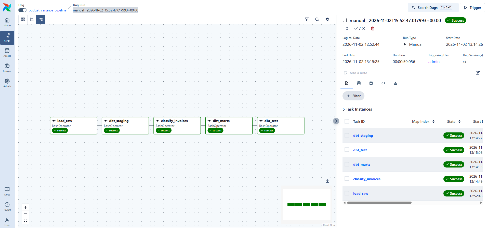

# Budget Variance Pipeline

"A daily finance pipeline comparing planned against actual spend by cost center,"
expense category and month. It ingests invoices from a simulated ERP export and
"daily exchange rates from a public API, models them with dbt on PostgreSQL, and uses"
an LLM to classify the invoices that arrive with no expense category.

"Uncategorized spend went from 15.4% to 0% of 61M USD, at 95% classification accuracy"
measured against a labelled set of 6550 invoices.

**[Interactive walkthrough](https://claude.ai/artifact/QDHEow5LQJtBXDDVBJWmfF)** — step through the seven stages and follow a single invoice all the way from the
ERP export to the variance report. Source in `docs/pipeline.html`.

## Results

"- 6550 invoices over 12 months, 61M USD of net spend, in USD, EUR and ARS"
- Uncategorized spend reduced from 15.4% to 0%
"- 1002 invoices classified by the agent, 95.01% of them correctly"
- Every row records whether its category came from the source system or the model
"- 62 dbt tests, including one asserting the variance mart reconciles with the"
  invoice fact table to the cent

"The errors concentrate in one pair of categories, shipping read as office supplies."
Part of that is label ambiguity rather than model failure. The model's self-reported
confidence does not correlate with being right: it was wrong at an average confidence
"of 0.89, which rules out a confidence threshold as a review gate."

## How it works

"`source_system/` writes daily CSV exports to `landing/`, with deliberate defects:"
"duplicated invoice ids, missing categories, negative amounts for credit notes, orphan"
"cost center ids, and due dates before the issue date. `ingestion/` loads them into the"
`raw` schema and fetches daily USD rates from the Frankfurter API.

"dbt models it in three layers. Staging renames, casts and deduplicates. Intermediate"
"classifies credit notes, maps orphan cost centers to an unknown member, and builds a"
daily exchange rate spine that forward fills weekends and holidays. Marts hold the
dimensions and the two fact tables.

"The classification agent runs between two dbt invocations. dbt cannot call an API, so"
"it has to be a Python step: it reads the invoices staging left without a category,"
"asks the model, and writes to `ml.invoice_category_predictions` for the marts to pick"
up. Airflow orchestrates the whole thing daily.

## Design decisions

**The raw layer has no uniqueness constraints.** A primary key on invoices would
"reject the whole COPY when a duplicate arrives, losing the valid rows in the same file."
"Duplicates are resolved in dbt, where the resolution is visible and tested."

"**The agent keeps history, not state.** One row per prediction, with model name,"
"prompt version, confidence and timestamp. That is what makes comparing prompt"
versions possible instead of overwriting the evidence.

**The run is resumable.** The agent selects invoices with no prediction for the
"current prompt version. It hit a daily token limit halfway through once, at 488 of 962"
invoices. Nothing was lost and the next run picked up where it stopped.

"**The reported category always beats the predicted one**, and `category_source` says"
which is which. A model prediction never overwrites what a human reported.

**The pipeline does not depend on the agent.** The join is a left join and the marts
task carries `trigger_rule="all_done"`. If the agent fails the marts are rebuilt
"anyway, the invoices it missed show up as uncategorized instead of quietly looking"
"normal, and the DAG still goes red so the failure is visible."

**The labelled set never touches the pipeline.** The labels live in their own table
"and the evaluation queries live outside the dbt project, so no model can reference"
them. Measuring a result with the same answer used to build it is structurally
"impossible here, not merely discouraged."

"**Credit notes are stored as negative amounts**, so `sum(amount_usd)` is net spend and"
filtering on `transaction_type` gives gross.

## Stack

"PostgreSQL 16, dbt 1.12.5, Apache Airflow 3.3.2, Python 3.13, Docker Compose. The LLM"
"is `openai/gpt-oss-20b` on Groq, with structured output validated by a Pydantic"
schema. Exchange rates from the Frankfurter API. Everything runs on free tiers.

## Layout

"    source_system/   Simulated ERP exports, including the deliberate defects"
    landing/         What the source system drops (not committed)
"    ground_truth/    True categories, for evaluation only (not committed)"
"    ingestion/       Loaders into raw, and the exchange rate client"
"    sql/             Numbered, additive migrations"
"    analytics/       dbt project: staging, intermediate, marts, tests"
    agent/           The invoice classification agent
"    evaluation/      Accuracy and error analysis, outside the dbt project"
    dags/            The Airflow DAG

## Running it

Copy `.env.example` to `.env` and fill in a Groq API key.

    docker compose up -d
    pip install -r requirements.txt

"Airflow needs its own metadata database: in pgAdmin at localhost:5050, run"
`CREATE DATABASE airflow;`. Then run the migrations in `sql/` in numeric order.

From the repository root:

    python source_system/export_dimensions.py
    python source_system/export_budget.py
    python source_system/export_invoices.py
    python ingestion/fetch_fx_rates.py
    python ingestion/load_raw.py
    python -m evaluation.load_ground_truth

    cd analytics && dbt deps && dbt build

"Airflow is at localhost:8080, with the generated password in `.airflow/passwords.json`."
Enable `budget_variance_pipeline` and trigger it. The evaluation queries in
`evaluation/` are plain SQL and run in pgAdmin.

## Next steps

- Batch several descriptions per LLM call. Each call spends around 600 tokens and most
"  of it is the instruction block, repeated once per invoice."
"- A second prompt version to compare against the first, with few shot examples drawn"
  only from invoices that already carry a reported category.
"- A review queue keyed on the measured error rate per category, since confidence"
  turned out to be useless as a gate.
- CI running `dbt build` against a Postgres service container.
- Incremental models. The pipeline currently full refreshes 12 months on every run.
